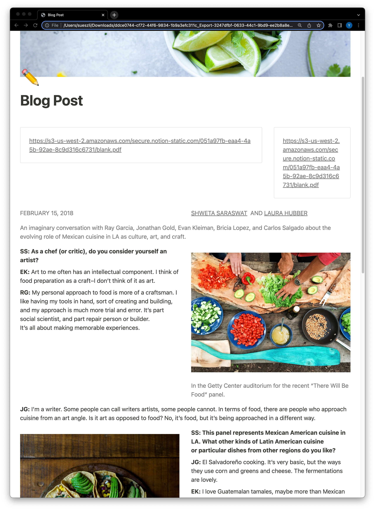
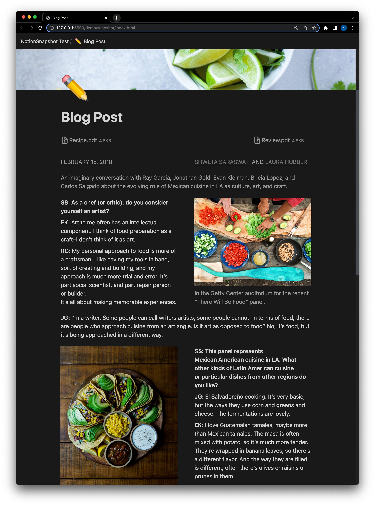

```
    _   __      __  _                _____                        __          __
   / | / /___  / /_(_)___  ____     / ___/____  ____ _____  _____/ /_  ____  / /_
  /  |/ / __ \/ __/ / __ \/ __ \    \__ \/ __ \/ __ `/ __ \/ ___/ __ \/ __ \/ __/
 / /|  / /_/ / /_/ / /_/ / / / /   ___/ / / / / /_/ / /_/ (__  ) / / / /_/ / /_
/_/ |_/\____/\__/_/\____/_/ /_/   /____/_/ /_/\__,_/ .___/____/_/ /_/\____/\__/
the ultimate notion scraper                       /_/

Usage:

$ uv run notionsnapshot/__main__.py --help
$ uv run notionsnapshot/__main__.py --dark-mode https://sueszli.notion.site/NotionSnapshot-Test-tiny-page-4dfa05657f774b45993542da4a8530c2

Requires uv. Playwright downloads Chromium on the first run.
```

|  |  |  |
| :---------------------------------------------: | :-----------------------------------------------: | :-----------------------------------------------: |
|               Export with Notion                |        Scraped with ✨NotionSnapshot✨        |                   Original page                   |
